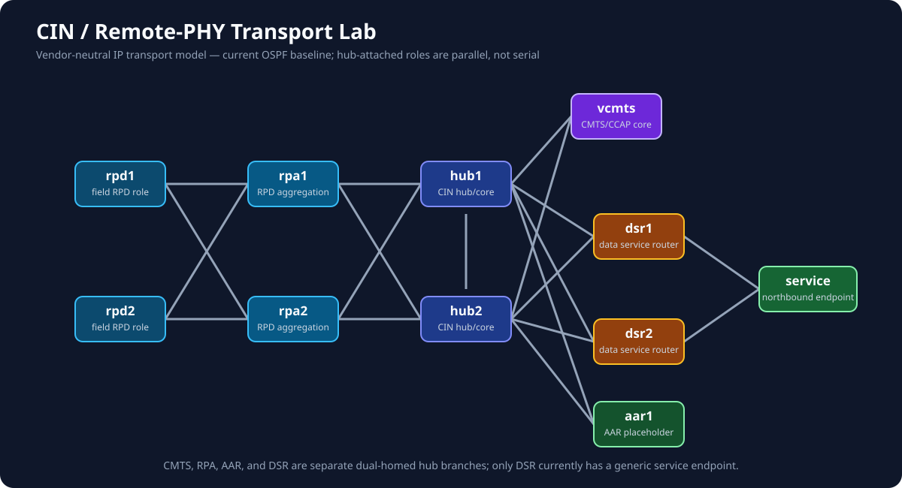

# CIN / R-PHY Transport Lab

This lab models the **IP transport** portion of a distributed-access cable
network. `rpd1`, `rpd2`, `rpa1`, `rpa2`, and `vcmts` are functional labels on
FRR containers: they do not emulate DOCSIS RF, modem registration, RPD
GCP/R-DEPI/R-UEPI, or a vendor vCMTS.

The goal is to practice the network that carries those functions: redundant
RPD transport, hub-attached role redundancy, OSPF reachability, ECMP/failover,
DSCP observation, and fault-isolation. The current source remains an OSPF
baseline; a later, separately reviewed slice will replace it with the real
IS-IS/iBGP control-plane model.

## Topology



```text
                            vcmts
                              |
       rpd1/rpd2 → rpa1/rpa2 → hub1 ===== hub2 ← aar1
                                  |  \       /  |
                                  |   \     /   |
                                  +-- dsr1/dsr2-+
                                           |
                                        service
```

The real-world names and exact functions of a hub and RPA are
operator/vendor-specific. Here, the hub nodes represent the CIN core/hub tier,
RPA nodes represent the RPD-facing aggregation tier, and DSR nodes represent a
redundant data-service-router tier. `aar1` is a neutral Access-Aggregation
Router role placeholder: it is independently dual-homed to both hubs and has
no invented downstream service behavior. It does not claim the real site has
exactly one AAR or establish what the acronym expands to.

Every current transport link runs OSPF area 0. RPD loopback stand-ins are
`10.255.1.1` and `10.255.1.2`; the vCMTS stand-in is `10.255.2.1`; DSR
loopbacks are `10.255.3.1` and `10.255.3.2`; the AAR placeholder loopback is
`10.255.4.1`; the service endpoint is `198.18.100.10`.

The real CIN design is known to use IS-IS over its transport and iBGP over
routed loopbacks. The real Junos RPA separates `vme.0` management from the
`lo0` IS-IS loopback. Those are the next control-plane and management-alignment
slices; the current FRR Containerlab `eth0` management network is only a
functional analogue of `vme.0`, not Junos emulation.

## Deploy and validate

```bash
cd cin-rphy-transport
sudo -E containerlab deploy -t cin-rphy-transport.clab.yml
chmod +x verify.sh
./verify.sh
```

## Read-only Ansible RPA interface probe

`ansible/` contains a read-only probe that reports each RPA interface facing an
RPD, its live IPv4 address/state, and its intended RPD association. See
[`ansible/README.md`](ansible/README.md) for controller requirements and the
run command. This lab does not run LLDP, so the RPD association is declared
as topology intent while interface state is collected live.

## First practice ticket: one RPD transport leg failed

**CIN-001 — RPD1 transport resilience:** Monitoring reports that RPD1's
primary transport leg is unavailable. Service through the remaining transport
leg should remain available.

From `rpd1`, establish the baseline:

```bash
show ip ospf neighbor
show ip route 198.18.100.10/32
ping 198.18.100.10
```

When ready to inject the fault, on the Containerlab host run:

```bash
docker exec clab-cin-rphy-transport-rpd1 ip link set eth1 down
```

Diagnose from RPD1, both RPA nodes, and both hub nodes. Confirm that RPD1
retains traffic through `eth2`, then restore with `ip link set eth1 up`.

## Packet observation

Use EdgeShark on `rpd1:eth1` and `rpd1:eth2`, or generate marked test traffic:

```bash
docker exec clab-cin-rphy-transport-rpd1 ping -Q 0xb8 -c 5 198.18.100.10
```

This marks ICMP with the EF DSCP value for observation only; it does not claim
to emulate DOCSIS service-flow QoS.

## Destroy

```bash
sudo -E containerlab destroy -t cin-rphy-transport.clab.yml --cleanup
```
