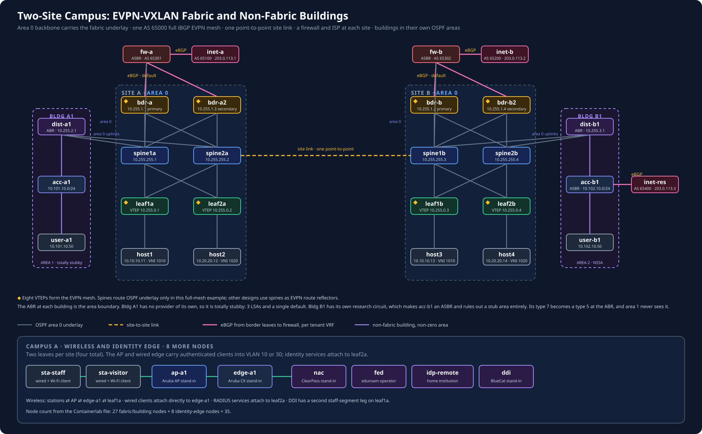

# Two-Site Campus: EVPN-VXLAN Fabric, Non-Fabric Buildings, Dual Internet Edge

Two site fabrics joined by one point-to-point link, one tenant stretched across
both, a border-leaf pair at each site, and a non-fabric building hanging off
each site in its own OSPF area. The fabric underlay is OSPFv2 area 0. The
overlay is AS 65000, with every VTEP peering directly with every other VTEP.

This models a multi-site campus of the shape people actually run: a modern
EVPN-VXLAN fabric for the data centre, traditional hierarchical OSPF for the
building networks that predate it, and one IGP domain spanning both.

## Topology

```text
                 SITE A                              SITE B
  inet-a (AS65100)                                    inet-b (AS65200)
        | eBGP                                    eBGP |
       fw-a                                            fw-b
     /      \                                        /      \
  bdr-a    bdr-a2                                  bdr-b    bdr-b2
     |  \   /  |                                    |  \   /  |
dist-a1-spine1a  spine2a ==== site link ==== spine1b  spine2b-dist-b1
   |     |  \  /  |                            |  \  /  |     |
acc-a1 leaf1a    leaf2a                     leaf1b    leaf2b  acc-b1
   |     |         |                           |         |     |
user-a1 host1    host2                       host3     host4  user-b1

AREA 1          <------------ AREA 0 ------------>        AREA 2
totally stubby       fabric underlay + core               NSSA
```

Spines are pure OSPF transit here. They run no BGP and never terminate VXLAN, so
the EVPN mesh has eight speakers: four access leaves and four border leaves,
with twenty-eight sessions.

Each border leaf connects to both local spines and to the site's firewall.
Access leaves connect to the spines. The spines route the underlay; border
leaves terminate tenant VXLAN and connect the fabric to outside networks.

**This follows from the full mesh, and it is not the vendor-default design.**
Cisco's guide calls the spine "the most logical place to put an MP-BGP EVPN
route reflector", and Cisco's own campus fabric tooling defaults to two or four
spine route reflectors. A full mesh removes the need for reflectors, which is
why the spines here carry no BGP — but if you are describing a fabric you did
not build, check whether its spines are reflectors. Most are. The `ibgp-rr`
lab in this repository covers the reflector pattern.



## OSPF area design

Area 0 covers the fabric underlay and the ABR uplinks. The fabric itself is a
single area on purpose. Cisco states it directly: *"The general recommendation
is to use a single area, 0, in the underlay. Multiple areas in the underlay are
possible to configure but unnecessary because the underlay's role is to provide
VTEP and BGP peering reachability."* Their scale argument is that a 1000-leaf
fabric produces roughly 2000 underlay LSAs, which any modern switch absorbs
without strain.

This is vendor design guidance, not a standard. No RFC requires it: RFC 7432 and
RFC 8365 are both underlay-agnostic, and RFC 7938 argues for dropping the IGP
entirely in favour of eBGP.

The buildings are where hierarchy belongs, and that is also documented practice:
the core stays in area 0 with each distribution block in its own area attached
to it, so a building becomes an area and its distribution node becomes the ABR.
That is exactly `dist-a1` and `dist-b1`.

The buildings are where hierarchy belongs. They end up with different area types
because they have different facts, not because the lab wanted variety:

| | Building A1 | Building B1 |
|---|---|---|
| Provider of its own | none | a research circuit, `inet-res` AS 65400 |
| Forced area type | free to choose | **NSSA** — nothing else is legal |
| Area | 1, totally stubby (`area 1 stub no-summary`) | 2, NSSA (`area 2 nssa`, RFC 3101) |
| LSDB | **3 LSAs** | **40 LSAs** |
| OSPF routes | **1** — a single default | **37** — default plus every type 3 summary |

A1 is an ordinary building. Nothing is redistributed inside it, so it has no
ASBR and every stub flavour is available; totally stubby is the tightest, and
there is no reason not to take it.

B1 has its own provider. `acc-b1` runs eBGP with `inet-res` and redistributes
that into OSPF, which makes it an ASBR — and **stub and totally stubby areas
forbid an ASBR outright.** NSSA is not a preference here, it is the only legal
choice, and that is precisely the gap RFC 3101 was written to fill.

So `acc-b1` originates the research network as a **type 7** inside area 2, and
`dist-b1` translates it to a **type 5** on the way into area 0. Area 1 never
sees it as an external at all, yet `user-a1` still reaches it over the default
its own ABR injects. `verify.sh` asserts every step of that.

## Design decisions

### How to read this lab

`ARCHITECTURE.md` records which choices come from the Cisco Cloud Fabric case
study, which are FRR/containerlab substitutions, and which remain open learning
exercises. Treat it as the design authority for this lab; do not infer a
vendor-specific implementation from a generic EVPN pattern.

The headline distinction is deliberate: `TENANT-A` has L3 VNI `4100` and
`EDUROAM` has L3 VNI `4200`. The L2 VNIs inside one VRF share that VRF's L3 VNI;
they do not share it across tenants. The `SERVICES` VRF exercise is intentionally
not built until its route scope and firewall policy are specified.

**One AS, full mesh, no route reflectors.** Eight VTEPs keeps the session count
visible while adding border redundancy. The cost is quadratic: each new VTEP
must peer with every existing VTEP. A larger fabric motivates route reflectors.

**Spines carry no BGP, because the overlay is a full mesh.** EVPN sessions ride
loopbacks that OSPF already advertises, so the spines only have to forward. This
keeps the underlay and overlay cleanly separable when you break one of them. It
is a consequence of the full-mesh requirement, not the industry norm — see the
note under Topology.

**The external handoff lives on each border-leaf pair.** Each border leaf has
a routed eBGP link to the site's firewall. The firewall peers with the ISP, so
the border leaves do not peer directly with the ISP. Campus A also carries
`EDUROAM` on a separate tagged link and VRF.

**The buildings are in the global table, not the fabric VRF.** They reach the
underlay and each other; they do not reach the EVPN tenants or the internet,
because that egress lives inside VRF `TENANT-A` on the borders. Joining the two
needs a fusion router or a firewall, and that is deliberately out of scope here.

**The firewall advertises only a default route to each border leaf.** Each
border advertises it as an EVPN type-5 route. Every leaf prefers its site's
primary border at local preference 200, then the secondary at 190. The far
site's borders remain the backup after both local paths fail.

**Anycast gateways by identical bridge MAC, plus ARP suppression.** Every leaf
carries both L2 VNIs with the same bridge MAC address and the same SVI address,
so `10.10.10.1` and `10.20.20.1` are live on all four leaves at once. That
sharing is also why `neigh_suppress` is switched on for every VXLAN bridge port.
Without it, a leaf floods the ARP for a remote host, and the reply is answered
by whichever leaf is local to that host, because they share the gateway MAC. The
requesting leaf never sees it. With it, the leaf answers from the EVPN type-2
MAC/IP routes and never floods. The hosts ping their gateway once at startup so
their leaf has a MAC/IP to advertise before anyone asks for it.

**The L3 VNI gets its own bridge.** `vxlan4100` sits in bridge `br4100`, and
`br4100` is the SVI enslaved to the VRF. Putting the VXLAN device straight into
the VRF leaves the VNI `State: Down` with no router MAC, and symmetric IRB never
comes up. All border leaves also need `advertise-all-vni`, even though they hold no
L2 VNI: without it zebra never registers the L3 VNI there and no type-5 route is
imported or originated.

## Address plan

| Role | Addresses |
|---|---|
| Site A fabric point-to-point | `10.0.0.0/24`, `/31` per link |
| Site B fabric point-to-point | `10.0.1.0/24`, `/31` per link |
| Site link | `10.0.2.0/31` |
| Building A1 | `10.0.3.0/24` links, lo `10.255.2.x`, users `10.101.10.0/24` |
| Building B1 | `10.0.4.0/24` links, lo `10.255.3.x`, users `10.102.10.0/24` |
| B1 research circuit | `198.51.100.8/31`, `inet-res` lo `203.0.113.3` |
| Spine loopbacks | `10.255.255.1` – `10.255.255.4` |
| Leaf VTEPs | `10.255.0.1` – `10.255.0.4` |
| Border VTEPs | `10.255.1.1` (A primary), `.3` (A secondary), `.2` (B primary), `.4` (B secondary) |
| Campus border to firewall | `198.51.100.0/31`, `.16/31` (A); `.2/31`, `.20/31` (B) |
| Visitor border to firewall | `198.51.100.10/31`, `.18/31` (A) |
| ISP loopbacks | `203.0.113.1` (A), `203.0.113.2` (B) |
| Tenant VNI 1010 | `10.10.10.0/24`, gateway `10.10.10.1` |
| Tenant VNI 1020 | `10.20.20.0/24`, gateway `10.20.20.1` |
| L3 VNI (VRF TENANT-A) | `4100` |

Host 1 and host 3 share VNI 1010 across campuses, which is the stretched-L2
case. Host 1 to host 4 crosses both a VNI and a campus, which is the symmetric
IRB case.

## Identity edge

`identity/` adds 802.1X, an eduroam federation, a second zone for visitors,
and DHCP/DNS, on top of this fabric. It is additive: nothing above changed
behaviour and `./labctl verify` still passes unchanged.

```sh
# ./labctl up builds campus-identity:1.1.0 and campus-firewall:1.0.0 from
# labs.toml before it deploys. Building by hand is only for debugging.
./labctl up
./labctl verify-identity
```

See `identity/README.md`. The short version: a staff member and an eduroam
visitor both authenticate over real EAPOL, the visitor's request is proxied
realm-by-realm to their home institution, and the visited site never learns
their username. The two land in different VRFs, and the visitor VRF has a
default learned from the firewall and no route to campus at all.

## Reconciliation

`reconcile/` joins the four registers that each know a third of the truth
about an endpoint — the fabric's type-2 table, the NAC's sessions, DDI's
leases and the firewall's address-keyed mappings — and reports where they
disagree. Read-only.

```sh
./labctl reconcile
```

The short version of why it exists: the fabric and the NAC are keyed on MAC,
the firewall is keyed on IP, and only the DHCP lease holds the edge between
them. See `reconcile/README.md`.

## Run it

```bash
./labctl check     # static validation of the whole repository
./labctl up
./labctl verify
./labctl verify-identity
./labctl status
./labctl down
```

`verify.sh` checks OSPF adjacency counts, seven established EVPN peers on each
of the eight VTEPs, stretched-L2 reachability, inter-VNI cross-campus
reachability, and internet reachability. It also checks the default-route order:
primary border, secondary border, then the far site's primary border.

## Control-plane policy practice

[`POLICY-EXERCISES.md`](POLICY-EXERCISES.md) is the quick-deploy guide for
prefix-lists, route-maps, local preference, communities, and controlled
BGP-to-OSPF redistribution. It changes policy on the existing nodes only and
uses `./labctl verify` as the regression check.

## Things to break

- Border failover is asserted by `verify.sh`. To watch the first step by hand,
  shut `bdr-a`'s firewall peer: `docker exec clab-evpn-vxlan-campus-bdr-a vtysh -c "conf t" -c "router bgp 65000 vrf TENANT-A" -c "neighbor 198.51.100.1 shutdown"`.
- Shut the site link and watch the EVPN mesh partition while each site keeps working internally. There is only one, by design, which is what makes it worth testing.
- `area 1 stub no-summary` &#8594; `area 1 stub` on `dist-a1`, then re-read `acc-a1`'s table: 1 route becomes many.
- Shut `spine1a:eth1` and confirm leaf1a holds its EVPN sessions through spine2a.

## Limits

- No EVPN multihoming (type 4 / ESI). Each host is single-attached.
- No border-gateway separation. The two sites are one flat EVPN domain and one
  IGP domain, not two domains stitched at a gateway. EVPN multi-site is the
  realistic next step and would give the sites independent failure domains.
- Each border pair connects to one firewall and one ISP per site. The lab
  models border-switch path failover, not firewall or provider redundancy.
  Containerlab does not model the hardware MC-LAG used by real switch pairs.
- The buildings do not reach the tenant VRFs or the internet. See above.
- Veth MTU is the containerlab default of 1500, so VXLAN leaves about 1450 for
  the payload. Large-packet tests need the MTU raised on the fabric links.
- The ISP nodes advertise a single loopback each. There is no internet table.
